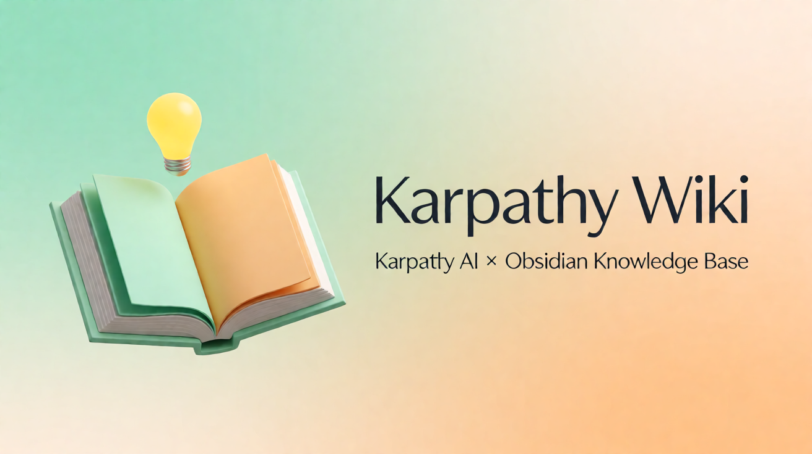

<div align="center">



# Karpathy Wiki

**Karpathy AI 内容 × Obsidian 知识库 —— 本地优先的可问答智能 Wiki**

*把散落的资料，编译成可检索、可问答、可追溯的知识库*

[](https://nodejs.org/)
[](https://vuejs.org/)
[](https://www.fastify.io/)
[](https://pnpm.io/)

</div>

## 简介

Karpathy Wiki 是一个**本地优先**的智能知识库系统：灵感来自 Andrej Karpathy 的「Agent = LLM + Harness」理念，形态借鉴 Obsidian 的 Markdown + 双向链接范式。

它用自研的 LLM Agent 引擎把零散资料**编译**成符合 SCHEMA 的结构化 Wiki 页面，并在这些页面之上提供图谱、健康检查、数据清洗与 RAG 问答。数据全程留在本机 Vault 目录，模型自带 Key（BYOK）。

核心闭环：

```
投递资料 → AI 编译 → 结构化页面 → 知识问答
```

## 解决什么问题

知识管理里常见的三个难题：

- **资料散**——制度、方案、会议纪要、聊天记录分散在网盘、群聊与个人电脑里；找不到、不敢删，越积越多。
- **检索弱**——关键词搜索只能命中字面，回答不了「跨文档、需要归纳」的问题；通用 AI 又看不到内部资料。
- **答案不可信**——公共大模型的答案无法回溯到原文，业务不敢采信，更不敢对外使用。

Karpathy Wiki 把「资料入库」做成一条四步闭环：投递资料 → AI 编译 → 结构化页面 → 知识问答。每一步都有可见的进度与可核对的产物——页面就是普通 Markdown 文件，答案中的引用可以直接点回原始页面，业务因此敢采信、也敢对外用。

## 四个关键差异

| 差异 | 含义 |
| --- | --- |
| **本地优先** | Vault 就是普通 Markdown 文件夹，可直接用 Obsidian 打开；随时可备份、迁移、审计，不被平台锁定。模型 Key 由使用者自持，知识资产不外流，成本与合规边界清晰。 |
| **编译而非堆砌** | 不是把文档切碎塞进向量库，而是按统一 SCHEMA 生成六类页面（`entities / concepts / comparisons / queries / qa / solutions`），标题、标签、关联字段整齐一致。 |
| **答案可溯源** | 问答结果内嵌 `[[页面名]]` 引用，检索命中来源逐条标注，每句结论都能回到出处。 |
| **可运维** | 健康检查、数据清洗与清理护栏把「能演示」变成「能长期维护」。 |

## 仓库结构

本仓库是多工程布局，根目录不设 npm 包，两个工程各自是独立 pnpm workspace：

```
.
├── karpathy-wiki/          # 应用工程（pnpm workspace：api + frontend）
│   ├── api/                # @karpathy-wiki/api —— Fastify 4 + TS 后端
│   ├── frontend/           # @karpathy-wiki/web  —— Vue 3 + Vite 前端（含移动端 Shell）
│   ├── scripts/            # 安装 / 启动 / 发布 / 部署脚本
│   ├── docs/               # 设计文档、SRS/HLD、术语表
│   └── assets/             # 设计稿与 GitHub 社交预览图
├── wiki-harness/           # @wiki/harness —— 轻量 LLM Agent 运行时（独立 workspace）
├── tooling/                # 治理脚本与性能测试（sonar 复核、TOC 校验、压测）
├── release/                # 统一发布产物目录（构建产物，已被 .gitignore 忽略）
└── logs/                   # 运行日志（同样不入库）
```

`karpathy-wiki/api` 通过 `file:../../wiki-harness` 引用 Agent 引擎，因此两个工程需保持同级摆放。

## 核心功能

八个模块覆盖「资料进来 → 知识成型 → 知识被使用 → 知识库被维护」的完整链路。每个模块末尾的截图标记为待补位（放置约定见文末[界面截图](#界面截图)）。

### 1. 多形态投递：资料不用先整理再入库

支持拖拽上传 Markdown 与文本、单文件与文件夹批量导入、PDF / Word / PPT / 图片解析、URL 抓取与书签导入，以及 QQ 群聊记录导入。投递原件统一留存于 `raw/` 目录，可由投递人自行下载核对。

> **价值**：先把资料收进来，再让 AI 去整理——降低知识库建设的启动门槛。

<!-- 截图待补：karpathy-wiki/assets/screenshots/ingest.png —— 投递页（多入口上传、批量投递与投递原件列表） -->

### 2. AI 编译引擎：过程可见、可续跑

编译由 ReAct 式工具循环驱动（`read_file` / `write_file` / `append_index` / `append_log`），通过 SSE 实时推送每一步进度；长任务支持断点续传（resume），配合预算守卫与上下文治理，避免「跑一半卡死」或成本失控。

> **价值**：一次投递几十份资料也能看清进行到哪一步，中断后可接着跑。

<!-- 截图待补：karpathy-wiki/assets/screenshots/progress.png —— 编译进度页（步骤流、工具调用与实时日志） -->

### 3. 浏览与双向链接：知识连成网络

页面采用 Obsidian 风格的原生 Markdown 与 `[[双向链接]]`，按 `entities / concepts / comparisons / queries / qa / solutions` 六类目录组织，另有非页面目录 `raw`（投递原件存档）与 `drafts`；索引与日志自动维护，支持全文检索与页面内编辑。

> **价值**：同一主题的知识自动互链，新同事顺着链接就能读懂上下文。

<!-- 截图待补：karpathy-wiki/assets/screenshots/browse.png —— 浏览页（目录树、页面正文与双向链接面板） -->

### 4. 知识问答（RAG）：跨文档提问，答案带引用

双路召回：FTS5 BM25 关键词检索 + BYOK embedding 语义检索，合并后流式生成回答；答案内嵌 `[[页面名]]` 引用，检索结果标注命中来源，并支持多会话与线程记忆，追问不必重复背景。

> **价值**：「我们上次是怎么处理这类问题的？」这类跨文档提问，能问、能答、能核对。

<!-- 截图待补：karpathy-wiki/assets/screenshots/query.png —— 问答页（流式回答、引用角标与检索命中来源） -->

### 5. 知识图谱：一眼看清结构

基于 vis-network 的交互式关联图，可按页面类型查看知识之间的引用关系，快速识别核心页面、断链与孤岛。

> **价值**：知识库从「一堆文件」变成「一张可探索的地图」。

<!-- 截图待补：karpathy-wiki/assets/screenshots/graph.png —— 图谱页（页面关联图与按类型筛选） -->

### 6. 知识体检与数据清洗：让知识库不腐化

自动检查孤立页、断链、重复标题等问题，并提供批量修复作业；清理动作受互斥锁、跨进程锁与写入口矩阵约束，避免并发清理互相踩踏或误删。

> **价值**：知识库可以长期演进，而不是上线三个月后变成新的垃圾场。

<!-- 截图待补：karpathy-wiki/assets/screenshots/health.png —— 知识体检页（问题分类） -->
<!-- 截图待补：karpathy-wiki/assets/screenshots/data-clean.png —— 数据清洗页（批量修复） -->

### 7. 多端与个性化：桌面与手机同一套知识

内置 8 套界面主题（商务浅白（默认）、暗色、马卡龙、现代企业、创意品牌、产品展示、电商零售、艺术作品集），并提供独立的移动端 Shell：问答、浏览、聆听、投递与个人中心一应俱全。

> **价值**：对外演示可换「产品展示」主题，对内使用可换「暗色」；现场用手机也能查。

<!-- 截图待补：karpathy-wiki/assets/screenshots/mobile.png —— 移动端 Shell -->
<!-- 截图待补：karpathy-wiki/assets/screenshots/themes.png —— 主题切换面板 -->

### 8. 开放集成与安全：既开放，又可控

- **开放**：MCP 接口把知识库能力暴露给外部 Agent，便于接入企业已有的自动化流程（见 [MCP 接口说明](karpathy-wiki/docs/mcp-interface.md)）。
- **远程**：Tailscale Funnel 一键公网访问，页面内提供前置条件自检，失败原因直接可见。
- **可控**：登录 / 注册 / 用户管理与 RBAC 权限分级，生产环境首次登录强制改密；`localOnly` 为本地调试模式（默认口令提示可见、不强制改密）。
- **合规**：模型走 OpenAI 兼容接口，Key 由使用者自持；数据不离开自有 Vault。

> **价值**：能力可以对外开放，数据与账号边界仍然握在自己手里。

<!-- 截图待补：karpathy-wiki/assets/screenshots/config.png —— 配置页（模型接入与用户权限） -->
<!-- 截图待补：karpathy-wiki/assets/screenshots/tunnel.png —— 隧道页（公网访问自检） -->

### 更多能力

- 🎙️ **播客与朗读**：把知识页生成播客脚本，回答支持 TTS 拟人朗读。
- 🖼️ **媒体生成**：生图 / 视频服务预设（BYOK）。

## 应用场景

| 场景 | 用法 |
| --- | --- |
| 企业知识管理 | 制度、产品资料、客服话术统一编译入库；新员工用问答自助上手，老员工用引用快速核对口径。 |
| 研发与交付团队 | 需求文档、接口规范、排障记录持续沉淀；交付现场用手机查历史处理方式，减少重复踩坑。 |
| 咨询与研究 | 把大量外部资料编译成可引用的结构化页面，写报告时直接引用页面与出处，降低核对成本。 |
| 个人知识库与内容创作 | 课程、访谈、读书笔记编译成体系；问答与图谱帮助发现主题之间的联系，成为内容创作的素材库。 |

## 与传统方式的对比

| 维度 | 共享网盘 | 通用 AI 问答 | Karpathy Wiki |
| --- | --- | --- | --- |
| 资料归属 | 文件散落，无统一结构 | 需上传第三方 | 本地 Markdown，可迁移可审计 |
| 检索方式 | 关键词 / 文件名 | 语义，但看不到内部资料 | 关键词 + 语义双路召回 |
| 答案可信度 | 依赖人工判断 | 无法回溯原文 | 页面引用可点开核对 |
| 长期维护 | 无体检机制 | 无 | 健康检查 + 清洗 + 清理护栏 |
| 使用成本 | 低 | 按 token 计费，资料外流 | 自有部署 + BYOK，成本可控 |

## 技术栈

| 层 | 选型 |
| --- | --- |
| 前端 | Vue 3.4 + Vite、Element Plus 2.6、Pinia 2.1、vis-network 10、markdown-it 14、mermaid 11、marpit |
| 后端 | Fastify 4.26 + `@fastify/multipart` / `static` / `helmet` / `cors` / `rate-limit` / `compress`、undici 8 |
| Agent 引擎 | `@wiki/harness` 0.1.0（TS，工具循环 / 预算 / 重试 / 运行态持久化） |
| 文档解析 | gray-matter（frontmatter）、pdf-parse、adm-zip、pptxgenjs |
| 语言与工具链 | TypeScript 5.4、tsx、Vitest 1.6、pnpm workspace、PowerShell/Bash 脚本 |
| 模型 | 智谱 GLM / 通义千问 / DeepSeek 等 OpenAI 兼容接口，BYOK |

## 安装

### 环境要求

| 依赖 | 版本 | 说明 |
| --- | --- | --- |
| Node.js | >= 22.19 | 下限由后端依赖 `undici@8` 的 `engines` 决定（`chokidar@5` 需 >= 20.19）；开发与实测环境为 Node 24 |
| pnpm | 推荐 | 仓库锁定 `pnpm@11.12.0`；未安装时安装脚本自动回退 npm |
| LLM API Key | — | GLM / Qwen / DeepSeek 任选其一 |

### 一键安装（Windows）

在 `karpathy-wiki` 目录下打开 PowerShell：

```powershell
.\scripts\install.ps1
```

脚本依次完成依赖安装、Vault 目录初始化与 4 步向导（确认 Vault 路径 → 选模型 + 输入 Key → SCHEMA 提示 → 完成）；未检测到 pnpm 时自动回退 npm。

- Vault 子目录清单取自 `karpathy-wiki/scripts/vault-dirs.mjs`（`api/src/vault/page-scope.ts` 的镜像，两者一致性由 `api/test/vault-dirs-single-source.test.ts` 断言），安装脚本不再写死目录名。
- `SCHEMA.md` 不存在时由 API 首次启动的 `VaultService.init()` 自动生成，也可在「配置」页编辑。
- 模型与路径配置写入 `api/config.json`（**不含** API Key）。
- API Key 写入 `api/.env`，该文件已被根 `.gitignore` 排除。

### 手动安装

```bash
cd karpathy-wiki && pnpm install     # api + frontend
cd ../wiki-harness && pnpm install && pnpm build   # 生成 @wiki/harness 的 dist/
```

## 快速开始

```powershell
# 一键启动前后端（推荐）
.\scripts\start.ps1
```

```bash
# 或分终端启动
pnpm dev:api   # 后端 http://localhost:3000
pnpm dev:web   # 前端 http://localhost:5173
```

打开 <http://localhost:5173>，按核心闭环走一遍：

1. **投递资料** —— 粘贴文本、上传 `.md` 或整个文件夹，点击「开始编译」。
2. **编译进度** —— SSE 实时显示工具循环步骤，完成后结果卡给出产出页面与索引更新状态。
3. **知识浏览** —— 目录树 + Markdown 预览，支持在线编辑与双向链接跳转。
4. **知识问答** —— 提问后检索知识库流式作答，答案内嵌 `[[页面名]]` 引用。

### 上手路径（约 15 分钟跑通第一次问答）

从零到第一次可核对的问答，四步：

| 步 | 做什么 |
| --- | --- |
| 第 1 步｜安装与初始化 | 执行安装脚本：检查 Node 版本 → 安装依赖 → 初始化知识库目录 → 向导式配置。 |
| 第 2 步｜配置模型 | 填入自有模型服务的 Base URL 与 Key（BYOK），在配置页完成连通性测试。 |
| 第 3 步｜投递第一批资料 | 选 3–5 份有代表性的文档（制度、方案、会议纪要），投递并观察编译进度。 |
| 第 4 步｜开始问答 | 在问答页提出一个跨文档问题，点开答案中的引用，核对到原始页面。 |

### 值不值得用，怎么判断

- **小范围验证**：用 3–5 份真实文档跑通「编译 → 问答 → 引用核对」，判断答案质量是否达到业务可用标准。
- **边界评估**：由 IT / 安全团队评估本地部署形态、账号体系与数据留存边界。
- **需要演示环境、部署清单或定制编译规则**：欢迎在仓库开 Issue 讨论。

## 配置

| 文件 | 用途 |
| --- | --- |
| `karpathy-wiki/api/config.json` | 业务配置，支持热加载；键含 `vaultPath`、`adapter`、`llm`、`budget`、`server`、`localOnly`、`healthCheck`、`tunnel`、`logging`、`webSearch`、`batch`、`mcp`、`knowledge`、`graph`、`refs` |
| `karpathy-wiki/api/config.example.json` | 配置样例（默认可参考此文件而非真实配置） |
| `karpathy-wiki/api/.env` | API Key（`GLM_KEY` / `QWEN_KEY` / `DEEPSEEK_KEY`），不进 git |
| `karpathy-wiki/api/llm-presets.json` | 内置 LLM 预设 |
| `karpathy-wiki/api/media-presets.json` | 生图 / 视频等媒体服务预设 |

> 前端「配置」页提供 AI 服务、联网搜索、生图/视频、工具（MCP/CLI/场景路由）、QQ 导入、隧道与主题等可视化入口；逐项脏标记，未保存不会静默覆盖。

## 部署与集成

Karpathy Wiki 面向「自己能部署、自己能掌控」的场景设计：

| 维度 | 说明 |
| --- | --- |
| 本地 / 内网部署 | Node.js 22.19 及以上，一条命令完成依赖安装与知识库初始化；数据保存在本机 Vault 目录。 |
| Windows 一键发布 | 发布脚本串联「构建 → 部署 → 重启 → 健康检查」，产物按时间戳目录发布并可回退。 |
| 公网访问 | Tailscale Funnel 内网穿透，页面内前置条件自检（已满足 / 未满足 / 待确认）。 |
| 外部系统集成 | MCP 接口（HTTP / JSON-RPC），把检索与问答能力开放给外部 Agent。 |
| 模型接入 | OpenAI 兼容接口，BYOK：智谱 GLM、通义千问、DeepSeek 等可选。 |
| 数据与备份 | Vault 为标准 Markdown 目录，可用 Git、网盘或任何文件备份工具管理。 |

## 构建与发布

```bash
cd karpathy-wiki
pnpm build                    # 各包 tsc / vite build
```

| 入口 | 作用 |
| --- | --- |
| `karpathy-wiki/scripts/一键发布.bat` | 构建 SPA → 部署到 `public_live_<时间戳>` → 重启生产服务 |
| `karpathy-wiki/scripts/publish-release.py` | 零依赖 GitHub Release 发布脚本：建 Release + 附带说明 md + 上传资产，凭据走 `GH_TOKEN` / git 凭据库，不落盘 |
| `karpathy-wiki/scripts/verify-publish.ps1` | 校验发布脚本自身的编码/格式规范（`.bat` 纯 ASCII + CRLF、`.ps1` UTF-8 BOM + 可解析） |
| `karpathy-wiki/scripts/deploy-linux/deploy.sh` | Linux 侧部署 |
| `karpathy-wiki/installer.iss` | Inno Setup 桌面安装包定义 |

SPA 资源根按动态顺序探测（`release/spa/public_live_*` 最新时间戳优先，逐级回退到 `frontend/dist`、`api/public` 等），`karpathy-wiki/api/src/spa-static.ts` 内注释维护该口径。前端发布由 `karpathy-wiki/api/_deploy_live.mjs` 在 safe-delete 沙箱内执行；线上以 `/wiki/` 前缀挂载时，`/wiki/api` 请求由后端进程内注入桥回环转发到同一实例的 API，二进制与 SSE 响应按字节透传。

## 测试

```bash
cd karpathy-wiki
pnpm --filter @karpathy-wiki/web test     # 前端 Vitest
pnpm --filter @karpathy-wiki/api test     # 后端 Vitest
cd ../wiki-harness && pnpm test           # Agent 引擎（node --test）
```

类型门禁：前端 `vue-tsc --noEmit`（已并入 `pnpm --filter @karpathy-wiki/web build`），后端 `tsc --noEmit` 与 `tsc -p tsconfig.test.json --noEmit`。当前规模约为前端 928 例 / 后端 1294 例（以仓库内测试文件为准）。

## 界面截图

[核心功能](#核心功能)各模块末尾留有 `<!-- 截图待补：... -->` 标记，共 11 处（投递、编译进度、浏览、问答、图谱、体检、清洗、移动端、主题、配置与隧道）。仓库当前**不含**运行界面截图，补齐方式：

1. 把图片放到 `karpathy-wiki/assets/screenshots/<模块>.png`（文件名沿用标记里给出的路径）。
2. 将标记整行替换为 `.png" alt="<模块名>" width="720">`。
3. 只用仓库内相对路径，确保 GitHub 渲染；提交前确认画面里没有真实业务资料、密钥或个人信息。

不预置截图的原因：示例画面来自本机 Vault，里面是使用者自己的资料；公开仓库不应携带这些内容。文档与演示请用空 Vault 或专门的中立资料截图。

## 术语速查

| 术语 | 含义 |
| --- | --- |
| Vault | 知识库的根目录，全部页面以标准 Markdown 文件存放，可直接用 Obsidian 打开。 |
| 编译 | 由 LLM Agent 把投递资料整理成结构化页面的过程，包含读取、生成、追加索引与日志等步骤。 |
| 投递原件 | 用户上传或抓取的原始文件，留存于 `raw/` 目录，可下载核对。 |
| RAG | 检索增强生成：先检索知识库，再让模型基于检索结果作答。 |
| BYOK | Bring Your Own Key：模型 Key 由使用者自行提供与保管。 |
| MCP | Model Context Protocol：把知识库能力以标准接口暴露给外部 Agent。 |

> 更完整的口径见[术语表](karpathy-wiki/docs/术语表.md)。

## 文档

- [子工程 README（应用视角详解）](karpathy-wiki/README.md)
- [产品介绍 Word 文档（市场推广版）](karpathy-wiki/docs/product/产品介绍-Karpathy-Wiki.docx)
- [快速上手指南](karpathy-wiki/docs/GETTING_STARTED.md)
- [交付文档（架构与模块清单）](karpathy-wiki/docs/DELIVERY.md)
- [MCP 接口说明](karpathy-wiki/docs/mcp-interface.md)
- [媒体服务配置](karpathy-wiki/docs/media-config.md)
- [数据清洗 SRS](karpathy-wiki/docs/data-cleaning-SRS.md) / [HLD](karpathy-wiki/docs/data-cleaning-HLD.md)
- [术语表](karpathy-wiki/docs/术语表.md)

## 贡献指南

1. 从 `main` 切出分支（`git checkout -b feature/xxx`）。
2. 改动前后确保相关包 `pnpm build` 与测试通过；涉及 UI 的行为变更请用真机实测复验。
3. 提交信息写清动机与影响范围；一个提交只做一件事，便于按票回滚。
4. 仓库对临时产物有明确的忽略口径（`**/_smoke_*`、`_stale_js_quarantine/`、`**/test-batch*/`、`release/`、`logs/` 等均不入库；可复用的进程内冒烟入口 `_smoke_inject.mjs` 是显式例外）。新增临时产物请先补 `.gitignore` 规则或用后清理，并且提交前用 `git ls-files -i -c --exclude-standard` 确认没有把本应入库的已跟踪文件圈进来。
5. 触碰删除面/清理逻辑前请阅读 `karpathy-wiki/api/src/utils/cleanup-surface.ts` 的写入口矩阵——该文件是删除能力的单一口径。

> 项目仍在快速迭代，核心接口与配置 schema 可能随版本调整；较大改动建议先开 Issue 讨论。

## 致谢

- [Andrej Karpathy](https://github.com/karpathy) —— 项目理念来源
- [Obsidian](https://obsidian.md/) —— Markdown 知识库与双向链接范式
- [Element Plus](https://element-plus.org/) / [Vue](https://vuejs.org/) / [Fastify](https://www.fastify.io/) / [vis-network](https://visjs.github.io/vis-network/docs/network/) —— 核心技术栈
